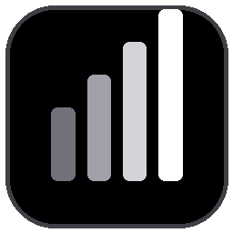

<p align="center">
  
</p>

# TokenScope

TokenScope reads the local session files of Claude Code, Codex and Antigravity and shows
tokens, estimated cost and remaining subscription quota per project and per model.
It runs as a Windows desktop app with a tray icon (`tauri/`), plus a React + FastAPI web app
with manual import and stored history (`frontend/`, `backend/`).

## Requirements

Desktop app:

- Windows 10 or 11 with the WebView2 runtime.
- To build: stable Rust toolchain. TODO: no minimum Rust version is pinned.

Web app:

- Python with the packages in `backend/requirements.txt`, and a running MongoDB.
  Reading compressed Codex sessions (`*.jsonl.zst`) needs Python 3.14 or later.
- Node.js with `yarn` or `npm` for `frontend/`.

## Install

Desktop app: download `TokenScope-Tauri.exe` from the [latest release](https://github.com/inerthel-agi/tokenscope/releases/latest). It is a single executable with no installer.

Desktop app, from source:

```bash
cd tauri
cargo build --release
```

The executable is `tauri/target/release/tokenscope.exe`.
Tagged releases (`v*`) attach a prebuilt `TokenScope-Tauri.exe`, built by `.github/workflows/build-tauri.yml`.

Web app:

```bash
cd backend
pip install -r requirements.txt
uvicorn server:app --reload --port 8000
```

```bash
cd frontend
yarn install
yarn start
```

## Usage

Start `tokenscope.exe`:

- The dashboard window opens. Drag its top bar to move it; the bar's buttons minimize, maximize and close it. Closing it keeps the app in the tray.
- Left-click the tray icon to open the quota popup. Right-click it for **Open dashboard** and **Quit**.
- `tokenscope.exe --minimized` starts in the tray only. The popup's **Start with Windows** option registers this command.
- Select a range (`24h`, `7d`, `30d`, `90d`, `life`) and a tool in the sidebar.
- Click a project row to filter the whole dashboard to it. Click the project chip to clear the filter.
- **Export CSV** and **Export JSON** save the current summary to `~/Downloads`.
- **Export power bi** asks for a folder (the dialog opens on the last one used) and writes the whole history there: `usage.csv` (one row per date, model and project), `models.csv`, `projects.csv` and `calendar.csv`. The first export to a folder also writes a Power BI project, `TokenScope.pbip`: open it in Power BI Desktop and select **Refresh**. It has three pages (Overview, Projects, Models) and loads the CSVs with US number formats. Later exports refresh the CSVs only and keep your edits to the report.
- A Windows notification appears when a Claude quota window reaches 90 % used, or a Codex window drops to 10 % left.

Data sources, read-only:

| Tool | Files |
| --- | --- |
| Claude Code | `~/.claude/projects/**/*.jsonl`, `~/.claude/.credentials.json` (OAuth token for quotas) |
| Codex | `~/.codex/sessions/` and `~/.codex/archived_sessions/` (`rollout-*.jsonl`, `rollout-*.jsonl.zst`), `~/.codex/auth.json`, `~/.codex/config.toml` |
| Antigravity | `~/.gemini/antigravity/conversations/*.db` |

The only outbound request is the Anthropic OAuth usage read for Claude quotas.
When the stored token has expired, the app runs `claude auth status` (at most once per 10 minutes) so the Claude CLI renews it.

## Configuration

Price overrides, read by the desktop app from `~/.tokenscope/pricing.json` and reloaded when the file changes:

```json
{"models": [{"match": "ox-alpha", "input": 3, "output": 15, "from": "2026-12-01"}]}
```

`match` is a case-insensitive part of the model id; the longest match wins. `input` and `output` are USD per million tokens. `from` (inclusive) and `until` (exclusive) are optional local dates.

Environment variables:

| Name | Default | Effect |
| --- | --- | --- |
| `TOKENSCOPE_DIR` | `~/.tokenscope` | Location of the theme, quota cache, `pricing.json` and `powerbi.json` (last Power BI export folder) |
| `TOKENSCOPE_CLAUDE_DIR` | `~/.claude` | Claude Code data directory |
| `TOKENSCOPE_CODEX_DIR` | `~/.codex` | Codex data directory |
| `TOKENSCOPE_GEMINI_DIR` | `~/.gemini` | Antigravity data parent directory |
| `TOKENSCOPE_CLAUDE_RPC_DIR` | `~/.claude-rpc` | Optional fallback quota cache |
| `TOKENSCOPE_ANTIGRAVITY_STATE` | `%APPDATA%/Antigravity/User/globalStorage/state.vscdb` | Antigravity state database (availability check) |
| `TOKENSCOPE_CLAUDE_OAUTH` | `1` | `0` disables the Anthropic usage request; cached quotas only |
| `MONGO_URL` | required | Web backend: MongoDB connection string |
| `DB_NAME` | required | Web backend: database name |
| `TOKENSCOPE_API_KEY` | empty | Web backend: when set, write endpoints require `X-API-Key` |
| `CORS_ORIGINS` | `*` | Web backend: comma-separated allowed origins |
| `MAX_UPLOAD_BYTES`, `MAX_IMPORT_ROWS` | 5 MB, 50 000 | Web backend: import limits |

## Limitations

- Costs are estimates from public list prices. Subscription usage is not billed per token.
- Models without a known price show **price unknown** and count as $0 until added to `pricing.json`.
- The desktop app is built and tested on Windows only. There is no macOS build.
- The web backend (`backend/local_sources.py`) does not read `pricing.json` and has no date-based Gemini prices.

## Project layout

```text
tauri/      Desktop app: Rust sources (src/), dashboard pages (ui-src/), build.rs
backend/    FastAPI server and local_sources.py (web app reader) with tests
frontend/   React web app
```

## License

MIT. See `LICENSE`.
